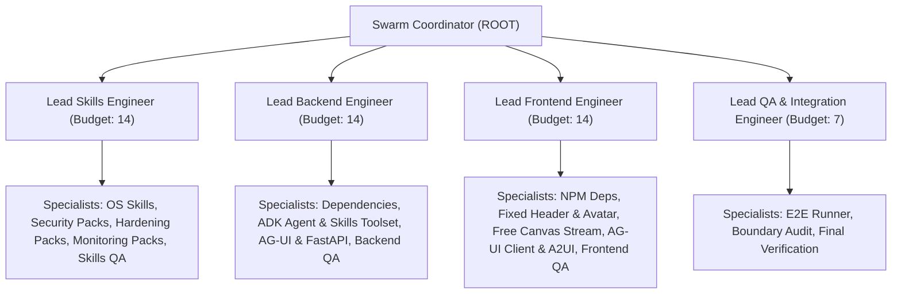

# AIDA Modernization: Swarm Architecture & System Contracts

## 1. Executive Summary & Objective
This document defines the architectural boundaries, contracts, and responsibilities for modernizing AIDA into a state-of-the-art diagnostic assistant featuring retro 16-bit PC-98 aesthetics, AG-UI protocol integration, A2UI generative interfaces, Google ADK Agent Skills, and Gemini 3.8 Flash (High Thinking).

Target Deadline: Presentation in < 3 hours.
Total Swarm Budget: 50 agents across 4 domain streams.

---

## 2. Swarm Org Chart & Stream Allocations



### Stream Budgets:
- **Lead Skills Engineer**: 14 agents
- **Lead Backend Engineer**: 14 agents
- **Lead Frontend Engineer**: 14 agents
- **Lead QA & Integration Engineer**: 7 agents
- **Root Coordinator**: 1 agent
- **Total**: 50 agents

---

## 3. Domain Boundaries & Interfaces

### Domain 1: Skills & Knowledge (`skills/`)
- **Directory**: `skills/` at repository root.
- **Deliverables**:
  - 3 Operating System Skills:
    - `skills/osquery-darwin/SKILL.md` (macOS: launchd, plist, keychain, authorization, certificates, etc.)
    - `skills/osquery-linux/SKILL.md` (Linux: systemd, deb/rpm packages, iptables, process sockets, shadow/passwd, etc.)
    - `skills/osquery-windows/SKILL.md` (Windows: registry, services, scheduled_tasks, bitlocker, windows_events, etc.)
  - 10 Specialized Query Pack Skills:
    - `skills/pack-osx-attacks/SKILL.md`
    - `skills/pack-incident-response/SKILL.md`
    - `skills/pack-vuln-management/SKILL.md`
    - `skills/pack-osquery-monitoring/SKILL.md`
    - `skills/pack-hardware-monitoring/SKILL.md`
    - `skills/pack-windows-attacks/SKILL.md`
    - `skills/pack-unwanted-chrome-extensions/SKILL.md`
    - `skills/pack-ossec-rootkit/SKILL.md`
    - `skills/pack-windows-hardening/SKILL.md`
    - `skills/pack-it-compliance/SKILL.md`
- **Format Contract**: Each skill is an ADK/Antigravity Agent Skill package with YAML frontmatter:
  ```markdown
  ---
  name: <skill-name>
  description: <clear natural language discovery description>
  ---
  # Instructions, osquery queries, table schemas, and diagnostic guidance
  ```
- **Loading Strategy**: Pure JIT loading via Google ADK `SkillToolset` (`list_skills`, `load_skill`, `load_skill_resource`).

---

### Domain 2: Backend Architecture (`aida/`, `main.py`, `pyproject.toml`)
- **Dependencies (`pyproject.toml`)**:
  - Remove `sqlite-rag`, `huggingface-hub`, `litellm`.
  - Add `ag-ui-protocol` and `ag-ui-adk` (from `refs/ag-ui` or local packages), `sse-starlette`, `google-adk>=2.3.0`, `google-genai>=2.9.0`.
- **Model Configuration**:
  - Model locked to `gemini-3.8-flash`.
  - Thinking level: `high` (`generate_content_config=types.GenerateContentConfig(thinking_config=types.ThinkingConfig(thinking_level="high"))`).
  - No model switching or debug mode endpoints.
- **Agent Definition (`aida/agent.py`)**:
  - Replace RAG tools (`discover_schema`, `search_query_library`) with `SkillToolset` configured with all skills loaded from `skills/`.
  - Retain `run_osquery` tool for live system diagnostics.
  - Integrate A2UI catalog instructions and validation for `aida_custom` catalog.
- **Server Endpoints (`main.py`)**:
  - Mount AG-UI protocol endpoint (`ag_ui_adk` using `add_adk_fastapi_endpoint`) streaming Server-Sent Events (SSE).
  - Add `/api/system-status` endpoint returning host system information (hostname, OS, kernel, uptime, CPU, memory) for the fixed header.
  - Retain static file serving for assets (`/idle`, `/talk`, `/think`, `/blink`, etc.) and frontend build.

---

### Domain 3: Frontend Architecture (`frontend/`)
- **Dependencies (`frontend/package.json`)**:
  - `@ag-ui/client` (^1.0.0), `@ag-ui/core` (^1.0.0).
  - `@a2ui/lit` (0.11.0), `@a2ui/web_core` (0.11.0).
  - Lit 3.3+.
- **Layout Requirements**:
  1. **Fixed Header (Top)**:
     - Basic system information (hostname, OS platform, kernel, uptime).
     - System health indicator (`HEALTH: NOMINAL [OK]`).
     - Status bar: Always-visible, reporting current operation in real-time ("IDLE - AWAITING INPUT", "EXECUTING QUERY: SELECT...", "THINKING...", "LOADING SKILL...").
     - AIDA's Avatar: Always visible in header, animated sprite loop according to agent state (`idle`, `speaking`, `thinking`, `error`).
  2. **Free Canvas (Bottom, Scrollable)**:
     - Chronological conversation stream: user prompts and AIDA's responses in retro terminal log.
     - Inline rendered rich A2UI elements (tables, charts, gauges, sliders, color pickers) inside conversation bubbles.
     - Prompt input at bottom: `AIDA> State your emergency...`.
  3. **Retro 16-bit PC-98 Aesthetics**:
     - VT323 monospace font, green/cyan/amber/red phosphor palette, scanline/CRT vibe.
     - Controllable UI aesthetics via A2UI (`AidaColorPicker`, `AidaSlider`) dynamically altering CSS variables.
  4. **AG-UI & A2UI Protocol**:
     - Connect using `@ag-ui/client` (`HttpAgent`).
     - Consume clean typed events (`TEXT_DELTA`, `TOOL_CALL_*`, `ACTIVITY_SNAPSHOT` / A2UI operations).
     - ZERO raw `<a2ui>` regex text parsing.

---

### Domain 4: Integration, E2E QA & Verification
- Unit test suite (`tests/` updated to test skills, osquery, and agent).
- Verification of live osquery queries.
- Verification of frontend build and asset serving.
- Placeholder and stub audit to ensure zero dangling `TODO` items.
